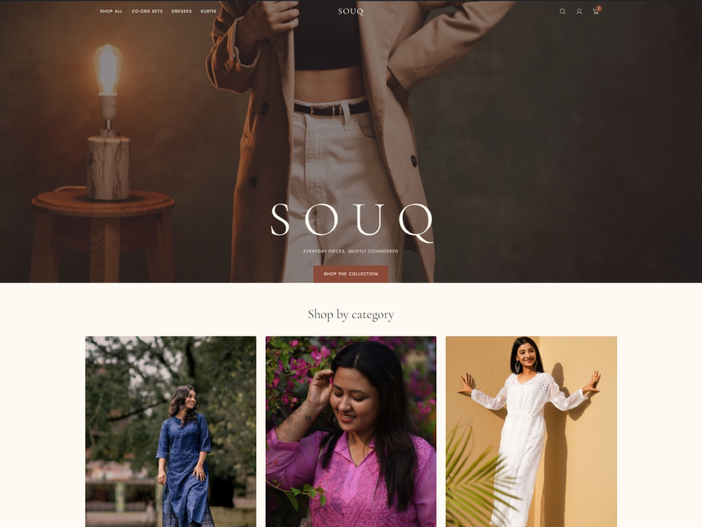

# Souq

<p align="center">
  
</p>

**Souq** is a modular, re-skinable WooCommerce storefront theme for fashion and apparel. It combines an editorial photography-led layout with practical commerce features including variation swatches, size charts, product galleries, Ajax search, recommendations, and a simplified Bangladesh-focused checkout.

[](https://github.com/2HAAS/souq/releases/tag/v0.2.9)
[](https://wordpress.org/)
[](https://woocommerce.com/)
[](https://www.php.net/)
[](https://www.gnu.org/licenses/old-licenses/gpl-2.0.html)

## Features

- **Fashion-first storefront** - Editorial layouts, portrait product imagery, and a focused card-less catalogue.
- **Variable product selectors** - Rectangular size buttons and circular colour swatches powered by WooCommerce variations.
- **Variation images** - Link a selected attribute term to an image from the product gallery.
- **Custom swatches** - Assign colours to WooCommerce attribute terms from the WordPress admin.
- **Product galleries** - Responsive thumbnails, keyboard-friendly controls, and variation-aware image updates.
- **Recommended products** - Display related merchandise with duplicate-product protection.
- **Size charts** - Maintain measurement tables with a tabbed, responsive purchasing panel.
- **Ajax search** - Fast storefront search with thumbnail results.
- **Localised checkout** - Bangladeshi district fields, simplified address fields, and Bangladesh defaults.
- **Easy re-branding** - Configure brand colours, typography, logo, header behaviour, and homepage sections in the Customizer.
- **Block-ready content** - Includes theme JSON settings and a dedicated Souq product-grid block.
- **Accessibility** - Semantic templates, keyboard controls, visible focus states, and screen-reader-friendly variation controls.

## Requirements

| Requirement | Minimum |
| --- | --- |
| WordPress | 6.4 |
| WooCommerce | 8.0 |
| PHP | 8.0 |
| MySQL / MariaDB | Compatible with WordPress requirements |

## Installation

### Download a release

1. Download `Souq-0.2.9.zip` from the [latest release](https://github.com/2HAAS/souq/releases/tag/v0.2.9).
2. In WordPress, open **Appearance > Themes > Add New > Upload Theme**.
3. Upload the ZIP, install the theme, and activate it.
4. Install and activate the [WooCommerce](https://wordpress.org/plugins/woocommerce/) plugin.

### Install from Git

From your WordPress project root, clone the repository into the `wp-content/themes` directory:

```bash
cd wp-content/themes
git clone https://github.com/2HAAS/souq.git Souq
```

Activate **Souq** from **Appearance > Themes**, then activate WooCommerce.

## Store Setup

1. Open **Appearance > Customize**.
2. Configure the brand logo, identity colours, typography, layout, and header.
3. Create primary and footer menus under **Appearance > Menus**.
4. Add WooCommerce categories and variable products.
5. Assign colours to global attribute terms.
6. Open a variable product and use the **Souq Variation Images** panel to connect swatches with gallery images.
7. Configure homepage content and sections from the Souq Customizer controls.
8. Complete WooCommerce settings for currency, tax, shipping, and payment methods.

## Development

This is a standalone WordPress theme with no build-step dependency.

```text
Souq/
├── assets/
│   ├── css/
│   ├── icons/
│   ├── images/
│   └── js/
├── inc/
│   ├── blocks/
│   └── woocommerce/
├── template-parts/
├── woocommerce/
├── docs/
│   └── screenshots/
├── front-page.php
├── functions.php
├── screenshot.png
├── style.css
└── theme.json
```

Changes to PHP templates, CSS, or JavaScript are picked up by WordPress directly. The packaged theme should be validated against the supported WordPress, WooCommerce, and PHP versions before release.

## Project Structure

| Area | Responsibility |
| --- | --- |
| `assets/css` | Theme, layout, component, and WooCommerce styles |
| `assets/js` | Galleries, search, product interactions, and admin controls |
| `inc/` | Theme setup, Customizer settings, SEO, assets, and blocks |
| `inc/woocommerce/` | Commerce overrides and Souq-specific WooCommerce features |
| `template-parts/` | Header, footer, homepage, and product partials |
| `woocommerce/` | WooCommerce template overrides |

## Releases

Published releases, source tags, branch references, and downloadable binaries are available on the [GitHub Releases page](https://github.com/2HAAS/souq/releases).

## Contributing

1. Create a focused feature or fix branch.
2. Make and test the change against WordPress and WooCommerce.
3. Keep WooCommerce template overrides compatible with the theme contract.
4. Submit a pull request with screenshots for visible UI changes.

## License

Souq is distributed under the [GNU General Public License v2 or later](https://www.gnu.org/licenses/old-licenses/gpl-2.0.html).
